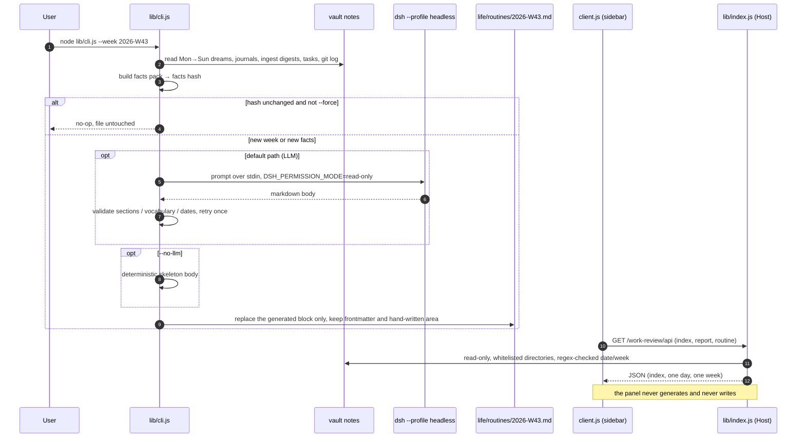

# dsh-work-review

[](https://github.com/Wang-Chuming/dsh-work-review/actions/workflows/ci.yml)
[](LICENSE)
[](package.json)

A **weekly review plugin for the [DeepSeek Harness](https://github.com/deepseek-ai/deepseek-harness)
Web GUI**: it reads one ISO week (Monday to Sunday) of your Dream morning briefs and journals in an
Obsidian-style vault, writes the week up as `<vault>/life/routines/<YYYY>-W<ww>.md`, and shows every
report back in a **read-only left-sidebar panel**.

> 中文说明见 [README.zh-CN.md](README.zh-CN.md)。

The vault keeps the daily record; this plugin turns seven days of it into one stable, reviewable
file — same facts, same bytes, rerun as often as you like.

## What it does

| Piece | Result |
| --- | --- |
| **Weekly routine** | `life/dreams/<date>.md`, `life/journal/<date>.md`, `life/notes/ingest/<date>.md`, `life/tasks/` and the week's `git log` become one markdown file: `<vault>/life/routines/<YYYY>-W<ww>.md` |
| **Idempotent file** | A generated block between `<!-- sleep-routine:generated -->` and `<!-- sleep-routine:generated:end -->` holds a facts hash. Same hash ⇒ nothing is rewritten. Anything you wrote after the end marker is never touched |
| **Optional LLM synthesis** | By default the body is written by your own local Harness (`dsh --profile headless`, your profile's model — no API key, no patch). `--no-llm` skips the model entirely and emits a deterministic, clearly-marked skeleton |
| **Sidebar panel** | 「工作回顾 / Work Review」 sits in the left sidebar below Automation tasks: a **day** tab (that date's Dream, falling back to the journal) and a **week** tab (the routine). Read-only — no generate button, no write button |
| **One-click review (opt-in)** | Configure a `review` command and the day view grows a **去审批 / Go review** button. Clicking it opens a **new session** with that command pre-filled as an unsent draft, so you press Enter yourself. Set `autoSend: true` to send it immediately instead. No config ⇒ no button |
| **Read-only API + agent tool** | Three `GET` routes under `/work-review/api` feed the panel; the `work_review_status` model tool answers “what did I do last week” from the same source |
| **One-click executor (opt-in)** | Configure an `approve` script and the day tab grows a **执行自动审批 / Run approval** button. It spawns that script detached (cwd = vault), shows 「运行中…」 while it runs, then the exit code. No new session, no chat context used — and it is the same entry point your scheduler uses |

## How it works



Two halves, one package:

- **Client half — `lib/client.js`.** Registers the sidebar entry in `sidebar.panellist` (`id: routine`,
  `order: 20`, so it lands under 「自动化任务」) and the full-page view in the layout's keyed
  `main` slot (`key: 'routine'`). It imports nothing outside the plugin — the shell renders it,
  and the panel talks to the Host over `fetch` only. “返回对话” calls `ctx.layout.selectPanel(null)`.
- **Host half — `lib/index.js`.** Registers the read-only routes on the Harness web server and,
  when a tools service is present, the `work_review_status` model tool. It reads four directories
  and nothing else; `date` / `week` are regex-validated before they ever reach a path join.
- **`lib/cli.js`.** The only writer, and only when you run it. It builds the facts pack, calls a
  provider, validates the output (structure, vocabulary, dates), then rewrites the file with only
  the generated block replaced.
- **`lib/core.js`.** Pure data layer: date/week arithmetic, Dream/journal parsing, task and git
  aggregation, frontmatter and section rendering, facts hashing, hand-written-area preservation.
  No DSH imports, no network, no model.
- **`lib/prompt.js`.** Facts → prompt, plus the output contract (four fixed `##` sections in order)
  and the vocabulary/date checks the CLI uses to reject a bad generation.

### The routes

| Route | Method | Purpose |
| --- | --- | --- |
| `/work-review/api/index` | `GET` | Day and week index: which dates have a Dream / journal / ingest digest, which routines exist, current ISO week |
| `/work-review/api/report?date=YYYY-MM-DD` | `GET` | One day: Dream markdown (preferred) and journal markdown |
| `/work-review/api/routine?week=YYYY-Www` | `GET` | One week: frontmatter title/status, full markdown, generated body, pull quote |

All three are served by the Harness web server inside your logged-in GUI session. There is no
`POST`, no `PUT`, no path parameter, and no write route of any kind.

### Where the configuration comes from

The vault location is resolved once, in this order:

1. `--vault <dir>` on the CLI;
2. the `DSH_WORK_REVIEW_VAULT` environment variable;
3. `vaultRoot` in `~/.dsh/work-review.json` (or the file named by `DSH_WORK_REVIEW_CONFIG`);
4. nothing — the CLI stops with a clear error, and the panel loads but tells you it is unconfigured.

No default vault path is baked into the code, so a fresh clone never points at somebody else's
notes.

## Requirements

- DeepSeek Harness with the Web GUI and plugin-bundle support (the package is a bundle layer: a
  Host row plus its client half).
- An Obsidian-style vault with the directory layout described under
  [Data layer contract](#data-layer-contract).
- Node.js ≥ 22 for the CLI and the test suite. At runtime the plugin imports **nothing but Node
  built-ins** and needs no build step and no npm dependencies.
- For the default provider: a working local `dsh` CLI. No API key and no patch file are required —
  the synthesis runs on whatever model your profile already uses.

Developed and verified on macOS.

## Install

### 1. Add the plugin to your profile

```bash
dsh plugin --profile <profile> add github:Wang-Chuming/dsh-work-review
```

`<profile>` is your profile name, for example `desktop`. Because the package declares `dsh.bundle`,
the command also adds the bundle row to `dsh.profile.bundles`. On the Desktop app you can install it
through the plugin manager instead, which does the same thing for the Desktop profile.

### 2. Point it at your vault

```bash
mkdir -p ~/.dsh
cat > ~/.dsh/work-review.json <<'JSON'
{
  "vaultRoot": "/path/to/your/vault"
}
JSON
```

That one field is enough. `~` is expanded, so `"vaultRoot": "~/Documents/vault"` works too.

### 3. Restart the app completely

Quit and reopen the Harness — a client-only reload is not enough, because the Host half reads the
config and registers routes at startup, and the client half is a bundle, not a hot-reloadable
resource.

Then confirm:

- the left sidebar shows 「工作回顾」 directly below 「自动化任务」;
- opening it lists your days and weeks, and the footer shows the vault path it resolved;
- the `work_review_status` tool is available to the model in a new conversation.

### Development install (clone + link)

```bash
git clone https://github.com/Wang-Chuming/dsh-work-review.git /path/to/dsh-work-review
```

Add `"@dsh-external/dsh-work-review": "link:/path/to/dsh-work-review"` to the profile's
`dependencies` and the same name to `dsh.profile.bundles`, run `pnpm install` in
`~/.dsh/profiles/<profile>`, then restart. The bundle row itself is shipped by the package in
`cordis.patch.yml` — you do not write it by hand.

## Usage

The CLI is the only part that writes. Run it from a checkout:

```bash
# last complete week (what a Sunday-night schedule would run)
node lib/cli.js --week last

# one specific ISO week
node lib/cli.js --week 2026-W43

# this week so far
node lib/cli.js --week current

# inspect the facts without calling a model and without writing anything
node lib/cli.js --week 2026-W43 --dry-run

# deterministic body, no model at all
node lib/cli.js --week 2026-W43 --no-llm

# regenerate even though the facts hash matches
node lib/cli.js --week 2026-W43 --force
```

| Flag | Meaning |
| --- | --- |
| `--week <spec>` | `last` \| `current` \| `YYYY-Www` \| a negative offset such as `-1` (default `last`) |
| `--vault <dir>` | Vault root for this run, overriding the env var and the config file |
| `--out-dir <dir>` | Where the routine file goes (default `<vault>/life/routines`) |
| `--provider <id>` | `auto` (default), `dsh-default`, or any configured provider id |
| `--dry-run` | Print the facts summary and prompt statistics; no model, no writes |
| `--facts-out <path>` | Write the facts pack as JSON |
| `--prompt-out <path>` | Write the full prompt to a file (debugging) |
| `--body-file <path>` | Use an existing markdown body instead of calling a provider |
| `--no-llm` | Deterministic skeleton body, marked as not synthesized |
| `--force` | Ignore the facts hash and synthesize again |
| `--timeout <sec>` | Per-provider timeout (default `600`) |
| `--allow-vocab-warnings` | Vocabulary mismatches warn instead of blocking the write |
| `--no-retry` | Do not retry once after a validation failure |
| `--rewrite-frontmatter` | Rebuild the frontmatter; the hand-written area is still preserved |
| `--quiet` | No stderr log lines |
| `-h`, `--help` | Print help |

`--dry-run` is the safe way to see what the week would contain. It prints a JSON summary and stops:

```json
{
  "week": "2026-W43",
  "range": ["2026-10-19", "2026-10-25"],
  "complete": true,
  "target": "/path/to/your/vault/life/routines/2026-W43.md",
  "unchanged": false,
  "commits": 12,
  "tasksTouched": 4,
  "promptChars": 9120
}
```

Exit codes: `0` written or already up to date, `2` bad arguments or environment, `3` the generated
body failed validation (nothing is written), `4` every provider failed (nothing is written).

## Configuration

Recommended: `~/.dsh/work-review.json`. Every path accepts `~`, and a relative `providers[].patch`
is resolved against the vault root.

| Field | Default | Meaning |
| --- | --- | --- |
| `vaultRoot` | *(required)* | Absolute path of the vault. Missing ⇒ the CLI errors out; the panel loads but reports “not configured” |
| `outDir` | `<vault>/life/routines` | Where routine files are written |
| `cacheDir` | `~/.cache/work-review` | Run logs and rejected model output. Never inside the vault |
| `dshCli` | auto-detected, then `dsh` | Path of the `dsh` executable used for synthesis |
| `providers` | `[]` | Extra synthesis backends, for advanced use (see below) |
| `review` | *(unset)* | Opt-in「去审批」button. Unset ⇒ the button never renders and the panel stays purely read-only (see below) |

| Environment variable | Meaning |
| --- | --- |
| `DSH_WORK_REVIEW_VAULT` | Vault root, overriding the config file but not `--vault` |
| `DSH_WORK_REVIEW_CONFIG` | Path of the config file itself (default `~/.dsh/work-review.json`) |
| `DSH_CLI` | Path of the `dsh` executable used for synthesis, overriding `dshCli` |

Resolution order, highest first: command-line flag → environment variable → config file → the
defaults in the table. A missing or malformed config file means “no overrides”, not a crash.

### Providers

The default, and for most vaults the only one you need, is the built-in **`dsh-default`**: the CLI
runs your own `dsh --profile headless` with your profile's model. It needs no patch file and no API
key, which is why nothing provider-shaped has to appear in your config.

`providers` is the advanced path, for a custom headless patch — for example one of several you keep
inside the vault:

```json
{
  "vaultRoot": "/path/to/your/vault",
  "providers": [
    {
      "id": "custom-headless",
      "label": "My headless patch",
      "keyEnv": "MY_HEADLESS_API_KEY",
      "patch": "patches/custom-headless.patch.yml"
    }
  ]
}
```

A provider's key is read from the environment variable named by `keyEnv`, then from
`~/.dsh/.credentials.yaml`. Configured providers join `dsh-default` as `--provider` values.
With `auto`, the configured providers are tried first — explicit intent wins — and `dsh-default`
is the last fallback; any provider whose patch file or key is missing is skipped with a log line
(silent with `--quiet`).

### One-click review

The panel stays read-only, so reviewing is opt-in and configuration-driven: the plugin never
hard-codes a workflow. Add a `review` block to the same config file:

```json
{
  "vaultRoot": "/path/to/your/vault",
  "review": {
    "label": "去审批",
    "command": "$sleep-review {date}",
    "autoSend": false
  }
}
```

| Field | Default | Meaning |
| --- | --- | --- |
| `command` | *(required)* | Prompt template. Without a non-empty value the block is ignored and no button renders |
| `label` | `去审批` | Button text |
| `autoSend` | `false` | `false` opens a new session with the prompt as an **unsent draft** (you press Enter). `true` creates the session and sends it immediately |
| `agentPreset` | *(unset)* | Optional agent preset for the new session |

Placeholders are filled in from the document you are looking at: `{date}`, `{week}`, `{title}`,
`{path}`, `{vault}`.

The button appears on the **day** tab, next to the document title. With `autoSend: false` the panel
opens a new conversation and puts the command in the composer — nothing runs until you press Enter.
If the running window cannot create sessions (older Harness build), the button falls back to copying
the prompt to the clipboard and tells you so.

## Data layer contract

These names are **stable**. Scripts, the panel and the agent tool all rely on them, so treat them as
an interface rather than as an implementation detail.

| Name | Contract |
| --- | --- |
| `life/routines/` | Where routine files live. Overridable per run with `--out-dir`, but the panel reads routine files only from here |
| `life/routines/<YYYY>-W<ww>.md` | File name: ISO week, with `ww` zero-padded to two digits |
| `type: routine` | Frontmatter type of every routine file |
| `<!-- sleep-routine:generated -->` | Start of the generated block |
| `<!-- sleep-routine:generated:end -->` | End of the generated block; everything after it is yours |
| `<!-- sleep-routine:facts-hash: … -->` | The facts hash that produced the block; the idempotence key |
| `~/.cache/work-review/` | Run logs and rejected model output. Never written inside the vault |

Inputs, all read-only: `life/dreams/<date>.md`, `life/journal/<date>.md`,
`life/notes/ingest/<date>.md`, `life/tasks/`, and `git log` for the week.

A routine file looks like this:

```markdown
---
type: routine
domain: life
title: "Routine 2026-W43（2026-10-19 → 2026-10-25）"
created: 2026-10-25
updated: 2026-10-25
status: final
tags:
  - dream-report
  - sleep
  - routine
related:
  - "[[life/journal/2026-10-19|2026-10-19 日记]]"
  - "[[life/dreams/2026-10-19|2026-10-19 Dream]]"
---

<!-- sleep-routine:generated -->
<!-- sleep-routine:facts-hash: 0123456789abcdef -->
# Routine 2026-W43

## 本周一句话
…

## 进展（按项目 / 任务）
…

## 反复出现的 blocker
…

## 未闭环
…

## 趋势
…

## 数据口径
…
<!-- sleep-routine:generated:end -->

## 手写区

Anything you write here survives every regeneration.
```

The first four sections come from the model (or from the skeleton, with `--no-llm`); `趋势` and
`数据口径` are rendered by the script so the numbers can never be invented. `status` is `final` for
a complete week and `draft` while days are still missing.

## Security & privacy

- **The panel cannot write vault files.** Every read route is `GET`-only; the single `POST` route
  (`/approve`) merely *spawns a script you configured* and returns its status — the plugin itself
  never edits a note. Routine files are written only by `lib/cli.js` (or by that script).
  Escalated/high-risk items stay with you: the default script is your own `sleep-review` entry point.
- **Directory whitelist.** The Host half reads `life/dreams`, `life/journal`, `life/notes/ingest` and
  `life/routines`; `date` and `week` are regex-validated before being joined into a path. No request
  parameter can reach another file.
- **No network.** The plugin itself never opens a connection, has no telemetry, and uploads nothing.
  The only model call is the local `dsh` child process the CLI spawns — and only when you ask for a
  synthesis.
- **The generator runs read-only.** The child process is started with
  `DSH_PERMISSION_MODE=read-only`, so the model cannot write even if it tries.
- **Keys stay out of the vault.** Provider keys come from your environment or `~/.dsh/.credentials.yaml`;
  they are passed to the child process, never printed, never written into a report.
- **Cache is outside the vault.** Logs and rejected model output go to `~/.cache/work-review/`.
- **Caching is local state, not a data source.** Deleting the cache loses only run logs.
- **Example data is fictional.** Everything in `test/` is invented for the tests; no real note,
  task title or path from anyone's vault ships with this repository.

## Limitations

- The panel cannot reach a session's input handle: it is a global panel, not a session view, so
  “插入输入框” degrades to copying the quote to the clipboard. Paste it into the conversation yourself.
- The panel is read-only by design. Generating still means running the CLI (or a schedule that runs
  it). The opt-in review button only **opens a session and fills a draft**; it does not approve or
  write anything by itself.
- The review button needs a Harness build that exposes the client `uiWorkspace` / `sessions`
  services. On an older build the button degrades to copying the prompt to the clipboard.
- The plugin depends on Harness-internal surfaces: the `sidebar.panellist` and `main` slots, the
  layout's `selectPanel`, and the `webServer` service. A Harness upgrade that changes them needs a
  matching plugin update.
- Your vault has to follow the Obsidian-style layout above; a flat folder of notes is not enough.
- Mostly developed and verified on macOS.
- The package is distributed through GitHub. The `@dsh-external` name is the author's plugin
  namespace — it is **not** published to npm, and `private: true` keeps it that way.

## Development

```bash
npm run check   # node --check on every JavaScript file
npm test        # node --test
```

| Path | Role |
| --- | --- |
| `lib/config.js` | Config and vault resolution: flags, environment, `~/.dsh/work-review.json` (incl. `review`), providers |
| `lib/core.js` | Pure data layer: dates, parsing, aggregation, rendering, hashing |
| `lib/prompt.js` | Facts → prompt, output contract, vocabulary and date checks |
| `lib/cli.js` | Generation entry point: facts → provider → validation → idempotent write |
| `lib/index.js` | Host half: read-only routes + `work_review_status` tool |
| `lib/client.js` | Client half: sidebar entry + panel |
| `test/fixtures/vault/` | Fictional mini-vault the tests read from |
| `test/*.test.mjs` | Node test suite: data layer, config resolution, routes, package contracts |
| `locale/{en,zh}.json` | Plugin manager title and description |
| `cordis.patch.yml` | Bundle layer shipped with the package |
| `cordis.patch.example.yml` | Inline-config reference form |

The test suite is self-contained: its facts come from the fictional mini-vault in
`test/fixtures/vault/`, and anything that writes goes to a temporary directory. It never reads,
writes or needs your real vault. The client half needs a real browser and a running Harness to
exercise; CI covers the Node side.

## Related

- [`dsh-obsidian-file-opener`](https://github.com/Wang-Chuming/dsh-obsidian-file-opener) — the same
  author's sibling plugin: a click on a vault file opens it in Obsidian (or another configured app)
  instead of the in-app preview. This plugin reads the vault; that one hands clicks over to it.
- [`awesome-dsh-plugin`](https://github.com/awesome-dsh-plugin/awesome-dsh-plugin) — the DSH plugin
  index, a good place to look next.

## License

[MIT](LICENSE) © 2026 Wang-Chuming
