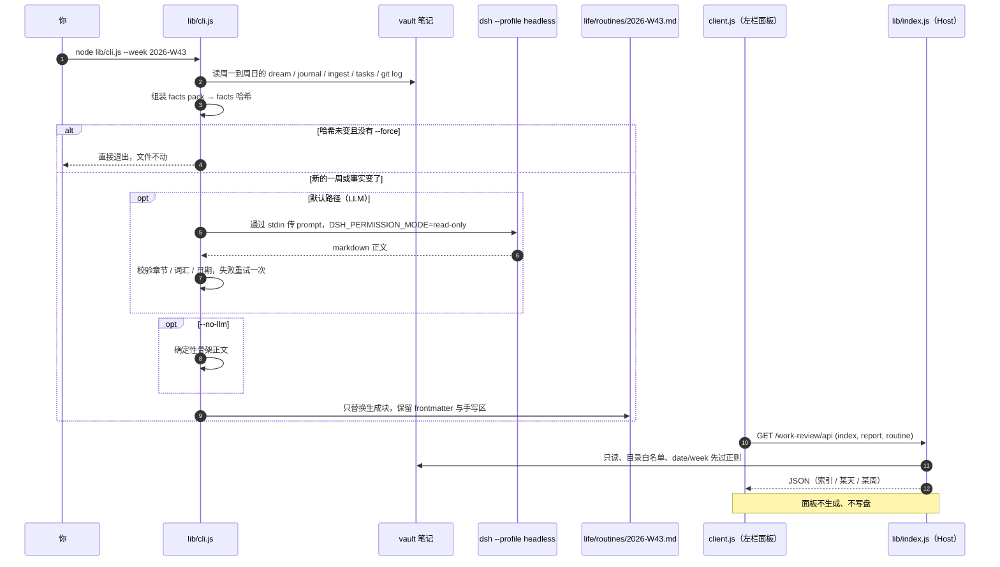

# dsh-work-review

[](https://github.com/Wang-Chuming/dsh-work-review/actions/workflows/ci.yml)
[](LICENSE)
[](package.json)

一个 **[DeepSeek Harness](https://github.com/deepseek-ai/deepseek-harness) Web GUI 的周报插件**：
它读取 Obsidian 风格 vault 里一个 ISO 周（周一到周日）的 Dream 早报与 journal，汇总成
`<vault>/life/routines/<YYYY>-W<ww>.md`，并在**左侧栏的只读面板**里展示这些日报与周报。

> English README: [README.md](README.md)

日报由 vault 保存，这个插件负责把七天整理成一份稳定、可复核的文件：同样的输入就是同样的字节，
重跑多少次结果都一样。

## 它做什么

| 部分 | 结果 |
| --- | --- |
| **周报正文** | `life/dreams/<date>.md`、`life/journal/<date>.md`、`life/notes/ingest/<date>.md`、`life/tasks/` 以及本周的 `git log` → `<vault>/life/routines/<YYYY>-W<ww>.md` |
| **幂等文件** | 生成块用 `<!-- sleep-routine:generated -->` 到 `<!-- sleep-routine:generated:end -->` 标出，内含 facts 哈希。哈希没变就不重写；结束标记之后是你手写的地方，永远不会被覆盖 |
| **可选 LLM 合成** | 默认调用你本机的 Harness（`dsh --profile headless`，用你 profile 里已有的模型，不需要 API key、不需要 patch）。加 `--no-llm` 则完全不调模型，只输出会明确标注的确定性骨架 |
| **左栏面板** | 「工作回顾」排在「自动化任务」下面：**日报** tab（当天的 Dream，缺失时回退 journal）与**周报** tab（该周周报）。只读——没有生成按钮，也没有写入按钮 |
| **一键审批（可选）** | 在配置里写一个 `review` 命令，日报标题旁就会多一个「去审批」按钮。点击会**新建一个会话**，把该命令预填成**未发送的草稿**，由你按回车确认；`autoSend: true` 才会直接发送。不配置就完全不显示按钮 |
| **只读 API 与 agent tool** | `/work-review/api` 下三个 `GET` 路由给面板供数；`work_review_status` tool 让 agent 从同一份数据回答「上周做了什么」 |
| **一键执行（可选）** | 在配置里写一个 `approve` 脚本，日报标题旁多一个「执行自动审批」按钮。点击后 host 在 vault 里**后台直接跑这个脚本**（cwd 固定为 vault），按钮显示「运行中…」，结束后显示退出码。不新开 session、不占对话上下文，跑的是和定时任务同一条入口 |
| **只读 API 与 agent tool** | `/work-review/api` 下三个 `GET` 路由给面板供数；`work_review_status` tool 让 agent 从同一份数据回答「上周做了什么」 |

## 工作方式



两半，一个包：

- **client half — `lib/client.js`。** 在 `sidebar.panellist` 注册左栏条目（`id: routine`、`order: 20`，
  所以排在「自动化任务」下面），在布局的 `main` keyed slot 注册整页视图
  （`key: 'routine'`）。它不 import 插件之外的任何东西；面板只通过 `fetch` 跟 Host 说话。
  「返回对话」调 `ctx.layout.selectPanel(null)`。
- **host half — `lib/index.js`。** 在 Harness web server 上注册只读路由；有 tools 服务时再注册
  `work_review_status`。它只读四个目录，`date` / `week` 先按正则校验，然后才会拼进路径。
- **`lib/cli.js`。** 唯一的写入者，而且只在你手动运行时写。它负责 facts pack、调用 provider、
  校验输出（结构、词汇、日期），再把生成块写回已有文件。
- **`lib/core.js`。** 纯数据层：日期/ISO 周换算、Dream 与 journal 解析、task 与 git 聚合、
  frontmatter 与章节渲染、facts 哈希、手写区保留。不依赖 DSH，不联网，不碰模型。
- **`lib/prompt.js`。** facts → prompt，以及输出契约（四个固定 `##` 章节及其顺序）和 CLI 用来
  否决坏生成的词汇/日期校验。

### 路由

| 路由 | 方法 | 用途 |
| --- | --- | --- |
| `/work-review/api/index` | `GET` | 日报/周报索引：哪些日期有 Dream / journal / ingest，哪些周报已存在，当前 ISO 周 |
| `/work-review/api/report?date=YYYY-MM-DD` | `GET` | 某一天：Dream 正文（优先）与 journal 正文 |
| `/work-review/api/routine?week=YYYY-Www` | `GET` | 某一周：frontmatter 的 title/status、全文、生成块正文、用于引用的摘句 |

三个路由都由 Harness web server 在你已登录的 GUI 会话里提供。没有 `POST`，没有 `PUT`，
没有路径参数，也没有任何写接口。

### 配置从哪来

vault 位置只解析一次，优先级从高到低：

1. 命令行 `--vault <dir>`；
2. 环境变量 `DSH_WORK_REVIEW_VAULT`；
3. `~/.dsh/work-review.json` 里的 `vaultRoot`（配置文件路径可用 `DSH_WORK_REVIEW_CONFIG` 覆盖）；
4. 都没有——CLI 报清晰的错误退出，面板能加载但会提示尚未配置。

代码里没有写死任何默认 vault 路径，所以刚 clone 下来时不会指向别人的笔记库。

## 要求

- 带 Web GUI 与 plugin bundle 支持的 DeepSeek Harness（这个包是一个 bundle 层：一个 Host 行
  加它的 client half）。
- 一个符合下文「数据层约定」目录结构的 Obsidian 风格 vault。
- Node.js ≥ 22，用于 CLI 与测试。运行时插件只 import Node 内置模块，没有构建步骤，也没有
  npm 运行时依赖。
- 用默认 provider 时：本机能跑 `dsh`。**不需要 API key，也不需要 patch 文件**——合成就用你
  profile 里已有的模型。

主要在 macOS 上开发和验证。

## 安装

### 1. 把插件加进 profile

```bash
dsh plugin --profile <profile> add github:Wang-Chuming/dsh-work-review
```

`<profile>` 是你的 profile 名，例如 `desktop`。因为包里声明了 `dsh.bundle`，这条命令还会把
bundle 行加进 `dsh.profile.bundles`。桌面端也可以直接用插件管理器安装，效果相同。

### 2. 指向你的 vault

```bash
mkdir -p ~/.dsh
cat > ~/.dsh/work-review.json <<'JSON'
{
  "vaultRoot": "/path/to/your/vault"
}
JSON
```

这一个字段就够了。`~` 会被展开，写 `"vaultRoot": "~/Documents/vault"` 也可以。

### 3. 完整重启 app

退出并重新打开 Harness。只刷新页面不够：Host half 在启动时读配置并注册路由，client half 是
bundle，不走热重载。

重启后确认：

- 左栏「工作回顾」出现在「自动化任务」正下方；
- 点开后能列出你的日期与周，页脚显示它解析到的 vault 路径；
- 新开一个对话，`work_review_status` 工具对模型可用。

### 开发用安装（clone + link）

```bash
git clone https://github.com/Wang-Chuming/dsh-work-review.git /path/to/dsh-work-review
```

把 `"@dsh-external/dsh-work-review": "link:/path/to/dsh-work-review"` 加进 profile 的
`dependencies`，把同一个名字加进 `dsh.profile.bundles`，在 `~/.dsh/profiles/<profile>` 里跑
`pnpm install`，然后重启。bundle 行本身由包里的 `cordis.patch.yml` 提供，不需要手写。

## 用法

只有 CLI 会写文件。在仓库目录里跑：

```bash
# 上一个完整周（周日晚上定时任务跑的就是这个）
node lib/cli.js --week last

# 指定 ISO 周
node lib/cli.js --week 2026-W43

# 本周（可能还不完整）
node lib/cli.js --week current

# 只看 facts，不调模型、不写文件
node lib/cli.js --week 2026-W43 --dry-run

# 完全不调模型
node lib/cli.js --week 2026-W43 --no-llm

# 哈希一致也强制重新生成
node lib/cli.js --week 2026-W43 --force
```

| 参数 | 含义 |
| --- | --- |
| `--week <spec>` | `last` \| `current` \| `YYYY-Www` \| 负数偏移如 `-1`（默认 `last`） |
| `--vault <dir>` | 本次运行的 vault 根目录，覆盖环境变量与配置文件 |
| `--out-dir <dir>` | 周报输出目录（默认 `<vault>/life/routines`） |
| `--provider <id>` | `auto`（默认）、`dsh-default`，或任一已配置的 provider id |
| `--dry-run` | 打印 facts 摘要与 prompt 统计，不调模型、不写文件 |
| `--facts-out <path>` | 把 facts pack 写成 JSON |
| `--prompt-out <path>` | 把完整 prompt 写到文件（调试用） |
| `--body-file <path>` | 用现成 markdown 正文代替 provider |
| `--no-llm` | 确定性骨架正文，并标注未经合成 |
| `--force` | 忽略 facts 哈希，强制重新合成 |
| `--timeout <sec>` | 单次 provider 超时（默认 `600`） |
| `--allow-vocab-warnings` | 词汇不符只告警，不阻断写入 |
| `--no-retry` | 校验失败后不再重试一次 |
| `--rewrite-frontmatter` | 重建 frontmatter，手写区仍然保留 |
| `--quiet` | 不往 stderr 打日志 |
| `-h`, `--help` | 显示帮助 |

`--dry-run` 是最安全的试跑方式，它只打印一份 JSON 摘要就退出：

```json
{
  "week": "2026-W43",
  "range": ["2026-10-19", "2026-10-25"],
  "complete": true,
  "target": "/path/to/your/vault/life/routines/2026-W43.md",
  "unchanged": false,
  "commits": 12,
  "tasksTouched": 4,
  "promptChars": 9120
}
```

退出码：`0` 已写入或本来就是最新；`2` 参数或环境错误；`3` 生成的正文没通过校验（不写文件）；
`4` 所有 provider 都失败（不写文件）。

## 配置

推荐放在 `~/.dsh/work-review.json`。所有路径都支持 `~`，相对的 `providers[].patch` 按 vault 根解析。

| 字段 | 默认值 | 含义 |
| --- | --- | --- |
| `vaultRoot` | *（必需）* | vault 的绝对路径。缺失时 CLI 报错退出，面板能加载但会提示未配置 |
| `outDir` | `<vault>/life/routines` | 周报写到哪 |
| `cacheDir` | `~/.cache/work-review` | 运行日志与被拒的模型输出，不写进 vault |
| `dshCli` | 先自动探测，再回退 `dsh` | 合成时用的 `dsh` 可执行文件 |
| `providers` | `[]` | 额外的合成后端，高级用法（见下） |
| `review` | *（不设）* | 可选的「去审批」按钮。不配置就完全不显示按钮，面板保持纯只读（见下） |

| 环境变量 | 含义 |
| --- | --- |
| `DSH_WORK_REVIEW_VAULT` | vault 根目录，覆盖配置文件但低于 `--vault` |
| `DSH_WORK_REVIEW_CONFIG` | 配置文件本身的路径（默认 `~/.dsh/work-review.json`） |
| `DSH_CLI` | 合成时用的 `dsh` 可执行文件，覆盖 `dshCli` |

优先级从高到低：命令行参数 → 环境变量 → 配置文件 → 上表默认值。配置文件缺失或格式错误只表示
「没有覆盖项」，不会让插件崩掉。

### Provider

默认也是绝大多数 vault 唯一需要的，是内建的 **`dsh-default`**：CLI 直接跑你本机的
`dsh --profile headless`，用你 profile 的模型。它不需要 patch 文件，也不需要 API key，所以你的
配置里通常根本不用出现 provider。

`providers` 是高级路径，用于接入自定义 headless patch，比如你放在 vault 里的某一份：

```json
{
  "vaultRoot": "/path/to/your/vault",
  "providers": [
    {
      "id": "custom-headless",
      "label": "My headless patch",
      "keyEnv": "MY_HEADLESS_API_KEY",
      "patch": "patches/custom-headless.patch.yml"
    }
  ]
}
```

provider 的 key 先读 `keyEnv` 指定的环境变量，再读 `~/.dsh/.credentials.yaml`。配置了 `providers`
之后，它们和 `dsh-default` 一起成为 `--provider` 的可选值。`auto` 先试配置里的 provider（显式
意图优先），`dsh-default` 作为最后的兜底；缺 patch 或缺 key 的 provider 会跳过并打一行日志（加 `--quiet` 则不打印）。

### 一键审批

面板本身是只读的，所以「审批」做成可选、由配置驱动——插件不硬编码任何工作流。在同一个配置文件里加：

```json
{
  "vaultRoot": "/path/to/your/vault",
  "review": {
    "label": "去审批",
    "command": "$sleep-review {date}",
    "autoSend": false
  }
}
```

| 字段 | 默认值 | 含义 |
| --- | --- | --- |
| `command` | *（必需）* | 提示词模板。没有非空值就整段忽略，不渲染按钮 |
| `label` | `去审批` | 按钮文字 |
| `autoSend` | `false` | `false`：新建会话并把模板填成**未发送草稿**（你自己按回车）；`true`：新建会话后直接发送 |
| `agentPreset` | *（不设）* | 可选，指定新会话使用的 agent preset |

模板里的占位符按你当前正在看的文档填充：`{date}`、`{week}`、`{title}`、`{path}`、`{vault}`。

按钮只出现在**日报** tab 的标题旁。`autoSend: false` 时，面板只负责新开会话、把命令放进输入框，
你不按回车它什么都不会执行；如果当前窗口不支持新建会话（较旧的 Harness），按钮会降级为把命令复制到
剪贴板并明确提示。

## 数据层约定

这些名字是**稳定的**。脚本、面板和 agent tool 都依赖它们，请当成接口而不是实现细节。

| 名字 | 约定 |
| --- | --- |
| `life/routines/` | 周报所在目录。单次运行可以用 `--out-dir` 改，但面板只读这个目录 |
| `life/routines/<YYYY>-W<ww>.md` | 文件名：ISO 周，`ww` 补零到两位 |
| `type: routine` | 每个周报文件的 frontmatter 类型 |
| `<!-- sleep-routine:generated -->` | 生成块起点 |
| `<!-- sleep-routine:generated:end -->` | 生成块终点；之后的内容归你 |
| `<!-- sleep-routine:facts-hash: … -->` | 产出该块的 facts 哈希，幂等判定就靠它 |
| `~/.cache/work-review/` | 运行日志与被拒的模型输出，永不写进 vault |

输入全部只读：`life/dreams/<date>.md`、`life/journal/<date>.md`、`life/notes/ingest/<date>.md`、
`life/tasks/`，以及本周的 `git log`。

一份周报文件长这样：

```markdown
---
type: routine
domain: life
title: "Routine 2026-W43（2026-10-19 → 2026-10-25）"
created: 2026-10-25
updated: 2026-10-25
status: final
tags:
  - dream-report
  - sleep
  - routine
related:
  - "[[life/journal/2026-10-19|2026-10-19 日记]]"
  - "[[life/dreams/2026-10-19|2026-10-19 Dream]]"
---

<!-- sleep-routine:generated -->
<!-- sleep-routine:facts-hash: 0123456789abcdef -->
# Routine 2026-W43

## 本周一句话
…

## 进展（按项目 / 任务）
…

## 反复出现的 blocker
…

## 未闭环
…

## 趋势
…

## 数据口径
…
<!-- sleep-routine:generated:end -->

## 手写区

写在这里的内容，重跑多少次都还在。
```

前四节来自模型（或 `--no-llm` 的骨架）；`趋势` 与 `数据口径` 由脚本渲染，数字不可能被编造。
`status` 在整周完整时是 `final`，还缺数据时是 `draft`。

## 安全与隐私

- **面板与 API 全只读。** 没有生成路由，也没有写路由。周报只由 `lib/cli.js` 写，而且只在你
  主动运行时写。
- **目录白名单。** Host half 只读 `life/dreams`、`life/journal`、`life/notes/ingest` 与
  `life/routines`；`date`、`week` 先过正则再拼路径，没有任何请求参数能指到别的文件。
- **不联网。** 插件本身不建立任何连接，没有遥测，不上传任何内容。唯一的模型调用是 CLI 启动的
  本机 `dsh` 子进程，而且只在你要求合成时才启动。
- **生成进程是只读的。** 子进程带 `DSH_PERMISSION_MODE=read-only` 启动，模型即使想写也写不了。
- **key 不进 vault。** provider key 来自环境变量或 `~/.dsh/.credentials.yaml`，只传给子进程，
  不打印、不写进周报。
- **缓存在 vault 外。** 日志和被拒输出都在 `~/.cache/work-review/`。
- **示例数据全是虚构的。** `test/` 里的一切都是为测试编的；仓库里没有任何真实笔记、任务标题或
  用户路径。

## 已知限制

- 全局面板拿不到 session 的输入框句柄：它是跨 session 的汇总面板，不是会话视图，所以
  「插入输入框」降级为把摘句复制到剪贴板，需要你自己粘贴回对话。
- 面板自己不会写 vault 文件：读取路由全是 `GET`；唯一的 `POST` 路由（`/approve`）只是
  **启动你配置的脚本**并回报状态，不碰任何笔记。要批量生成还是得跑 CLI（或让定时任务跑）。
  「去审批」按钮仍然只负责新开会话 + 填好草稿；「执行自动审批」按钮走脚本，退出码与日志都在
  面板上可见，命中例外清单的项依旧留给用户决定（由脚本里的分诊逻辑保证）。
- 「去审批」按钮需要当前 Harness 暴露客户端 `uiWorkspace` / `sessions` 服务；较旧的版本上
  按钮会降级为把命令复制到剪贴板。
- 插件依赖 Harness 内部接口：`sidebar.panellist` 与 `main` slot、布局的 `selectPanel`、
  `webServer` 服务。DSH 升级若改动这些，插件需要同步更新。
- vault 要符合上面的 Obsidian 风格目录约定；一个扁平的笔记目录不够。
- 主要在 macOS 上开发与验证。
- 包通过 GitHub 分发。`@dsh-external` 是作者的插件命名空间——**没有发布到 npm**，
  `private: true` 会一直保持这个状态。

## 开发

```bash
npm run check   # 对每个 JavaScript 文件跑 node --check
npm test        # node --test
```

| 路径 | 作用 |
| --- | --- |
| `lib/config.js` | 配置与 vault 解析：参数、环境变量、`~/.dsh/work-review.json`、provider |
| `lib/core.js` | 纯数据层：日期、解析、聚合、渲染、哈希 |
| `lib/prompt.js` | facts → prompt、输出契约、词汇与日期校验 |
| `lib/cli.js` | 生成入口：facts → provider → 校验 → 幂等写入 |
| `lib/index.js` | Host half：只读路由 + `work_review_status` tool |
| `lib/client.js` | Client half：左栏条目 + 面板 |
| `test/fixtures/vault/` | 测试读取的虚构 mini-vault |
| `test/*.test.mjs` | 数据层、配置解析、路由与包契约的 Node 测试 |
| `locale/{en,zh}.json` | 插件管理器里的标题与描述 |
| `cordis.patch.yml` | 包自带的 bundle 层 |
| `cordis.patch.example.yml` | 内联配置的参考写法 |

测试是自包含的：facts 来自 `test/fixtures/vault/` 里的虚构 mini-vault，需要落盘的部分写到临时
目录，既不读也不写你真正的 vault。client half 需要真实浏览器和运行中的 Harness 才能验证，CI
覆盖 Node 侧。

## 相关

- [`dsh-obsidian-file-opener`](https://github.com/Wang-Chuming/dsh-obsidian-file-opener) —
  同作者的姊妹插件：点击 vault 文件时用 Obsidian（或其它配置好的应用）打开，而不是在 app 内预览。
  本插件读 vault，那个插件把点击交给 vault。
- [`awesome-dsh-plugin`](https://github.com/awesome-dsh-plugin/awesome-dsh-plugin) — DSH 插件索引。

## 许可证

[MIT](LICENSE) © 2026 Wang-Chuming
