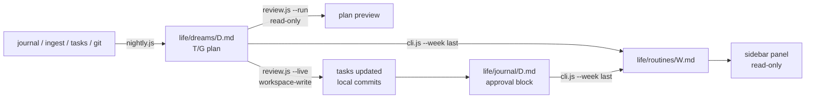

# Automation: from a day of work to a weekly routine

The panel and the CLI in `lib/` are already useful on their own. This directory is the
scheduler layer that closes the loop: **write the day down, let a model propose the plan,
let a script execute only the approved part, fold seven days into one reviewable file.**

Nothing here is a daemon. Every piece is a one-shot process you schedule with `launchd`,
`cron`, or your own runner; all state lives in the vault and in `~/.cache/work-review/`.

## The three jobs

| Job | Command | Writes | When |
| --- | --- | --- | --- |
| **Nightly Dream** | `node lib/nightly.js --date yesterday` | `life/dreams/<date>.md` | 05:05 daily, right after the day boundary |
| **Review pass** (opt-in) | `node lib/review.js --date <date> --run\|--live` | the plan's tasks + `life/journal/<date>.md` | chained after the Dream, or from the panel button |
| **Weekly routine** | `node lib/cli.js --week last` | `life/routines/<YYYY>-W<ww>.md` | Monday 06:00 |



The Dream is the contract between the two halves. It carries a numbered plan
(`T1…Tn` task updates, `G1…Gn` commits) and an `自动批准: 常规 | 升级` line on every item.
`review.js` executes **routine** items only; anything marked `升级`, missing an approval
line, or unnumbered is left for the human. That is the entire safety model — the model
proposes, a deterministic classifier decides what runs, and the script records what happened.

## Prerequisites

- `dsh` CLI on `PATH` (the Hermes `--profile headless` is what `lib/*.js` call), or set
  `dshCli` in `~/.dsh/work-review.json` / `DSH_CLI` in the environment.
- Node.js ≥ 22 (no npm dependencies; nothing to install).
- A vault with the layout described in the main README, plus a `vaultRoot` in
  `~/.dsh/work-review.json`.

## Run it once before you schedule it

```sh
# 1. see the facts and the prompt, write nothing
node lib/nightly.js --date yesterday --dry-run

# 2. write the Dream with the deterministic skeleton (no model, instantly)
node lib/nightly.js --date yesterday --no-llm

# 3. rehearse the review pass: it prints the plan, executes nothing
node lib/review.js --date <date> --dry-run

# 4. the weekly routine
node lib/cli.js --week last --dry-run
```

Then schedule it. Both wrappers take the date/week as `$1` and read the vault path from
the config file or `DSH_WORK_REVIEW_VAULT`:

```sh
automation/run-nightly.sh yesterday
automation/run-weekly.sh last
```

`launchd/` has two `.plist.example` files for macOS; `cron.example` has the equivalent
crontab lines. Replace `/ABSOLUTE/PATH/TO/dsh-work-review` and the vault path, then load.

## Environment variables

| Variable | Default | Meaning |
| --- | --- | --- |
| `DSH_WORK_REVIEW_VAULT` | config file | vault root, overrides `~/.dsh/work-review.json` |
| `DSH_CLI` | app bundle path | harness CLI used for synthesis |
| `WORK_REVIEW_DAY_START_HOUR` | `5` | an hour of the day at 05:00 belongs to the previous day |
| `WORK_REVIEW_AUTO_REVIEW` | `off` | `off` \| `dry` \| `live` — chain `review.js` after the Dream |
| `WORK_REVIEW_PROVIDER` | `auto` | provider id from `~/.dsh/work-review.json` |

`WORK_REVIEW_AUTO_REVIEW` defaults to `off` on purpose: the nightly job should be boring
for a week before you let it write anything. `dry` runs the review agent with
`DSH_PERMISSION_MODE=read-only`, so it can read the vault but cannot change it — you get a
plan and a prompt in the logs. Only `live` switches to `workspace-write`.

## Wiring the panel buttons

Both buttons in the day tab are opt-in and read their configuration per request, so you can
add them without restarting the app.

- **「去审批」/ Go review** — opens a new session with a prompt. Point it at the same script:

  ```json
  "review": { "label": "去审批", "command": "$sleep-review {date}", "autoSend": false }
  ```

- **「执行自动审批」/ Run approval** — spawns a deterministic script, no chat context used:

  ```json
  "approve": {
    "label": "执行自动审批",
    "python": "node",
    "script": "/ABSOLUTE/PATH/TO/dsh-work-review/lib/review.js",
    "args": ["--date", "{date}", "--live"]
  }
  ```

  `python` is just the executable name; `node` works. `script` may be absolute or
  vault-relative, `{date}` / `{vault}` are substituted at click time.

## What is protected, and what is not

- **Idempotent files.** The Dream lives inside
  `<!-- work-review:dream:generated --> … <!-- work-review:dream:generated:end -->` and
  carries a facts hash. Re-running with unchanged facts skips the model and does not touch
  the file; anything you wrote after the end marker is never touched. The weekly routine
  works the same way with its `sleep-routine` markers.
- **Read-only until told otherwise.** Synthesis always runs with
  `DSH_PERMISSION_MODE=read-only`. The review pass is read-only unless `--live`.
- **No push, ever.** The review prompt forbids `push`/`pull`/`sync`, deletions and
  `git add -A`; local commits are the endpoint. Governance files (`AGENTS.md`, `SCHEMA.md`,
  `ARCHITECTURE.md`, `.specs/`, `scripts/`, `.githooks/`) are listed as read-only even if a
  plan approved them.
- **Failures are visible.** Validation failures leave the raw model output in
  `~/.cache/work-review/rejected-dream-<date>.md` and exit 3; a failed review pass leaves its
  raw output in `review-unparsed-<date>.md` and exits 6. Nothing is silently half-written.

## Exit codes

| Code | nightly.js | review.js |
| --- | --- | --- |
| 0 | written / unchanged | plan printed / executed | 
| 2 | bad args or vault config | bad args or vault config |
| 3 | output failed validation | Dream file missing |
| 4 | every provider failed | — |
| 5 | — | every provider failed |
| 6 | — | model output had no parsable result block |

## Day boundary

The default day is **05:00 → 05:00**, not 00:00 → 24:00: work done at 02:00 belongs to the
day you were still living, and the job runs at 05:05 when the vault is quiet. Change it with
`--day-start-hour` / `WORK_REVIEW_DAY_START_HOUR`; if you do, move the schedule to match.
